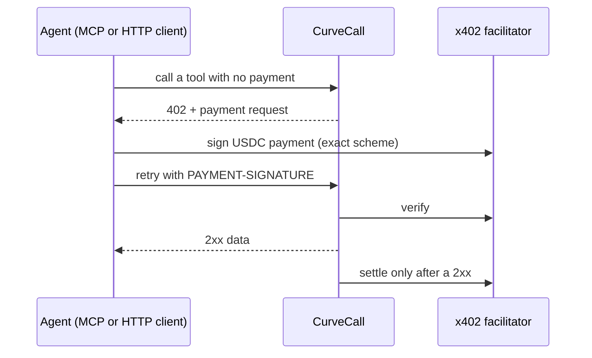

# CurveCall

**Pay-per-call market math and token intel for AI agents.** Quote a trade, check slippage and get rug-risk signals in one paid call. No API keys, no signup. Agents pay $0.001-$0.02 per call in USDC on Base via [x402](https://x402.org) v2. Built by [arbonomous](https://github.com/arbonomous).

<p align="center"><b><a href="https://curvecall.onrender.com">Live service</a></b> &middot; <a href="https://curvecall.onrender.com/openapi.json">OpenAPI</a> &middot; <a href="https://curvecall.onrender.com/mcp/">MCP endpoint</a> &middot; <a href="https://curvecall.onrender.com/llms.txt">llms.txt</a></p>

> **Repo map:** this public repo is the docs and discovery page for CurveCall. The service source code lives in a separate private repository and is not published here. Nothing in this repo runs the service.

CoinGecko tells you the price. CurveCall tells you what your buy will do.

## How it works



## Use it

- **MCP (streamable HTTP):** `https://curvecall.onrender.com/mcp/` - 10 tools, same x402 gating
- **HTTP API:** `https://curvecall.onrender.com` - service card at `/`, OpenAPI at `/openapi.json`
- **Agent card (A2A):** `https://curvecall.onrender.com/.well-known/agent.json`
- **llms.txt:** `https://curvecall.onrender.com/llms.txt`

Call any endpoint without `PAYMENT-SIGNATURE` to get the 402 payment request (x402 v2, `PAYMENT-REQUIRED` header).

## Tools

| Tool | Endpoint | Price |
|------|----------|-------|
| `quote_buy` | `GET /v1/quote/buy?quote_reserves=&token_reserves=&amount_in=` | $0.001 |
| `quote_sell` | `GET /v1/quote/sell?quote_reserves=&token_reserves=&amount_in=` | $0.001 |
| `token_snapshot` | `GET /v1/token/{chain}/{address}` | $0.005 |
| `token_risk` | `GET /v1/token/{chain}/{address}/risk` | $0.01 |
| `precheck` | `GET /v1/precheck/{chain}/{address}?side=&amount_in=` | $0.01 |
| `contract_check` | `GET /v1/token/{chain}/{address}/contract` | $0.01 |
| `wallet_snapshot` | `GET /v1/wallet/{chain}/{address}` | $0.005 |
| `search_tokens` | `GET /v1/search?q=&chain=` | $0.005 |
| `deployer_history` | `GET /v1/deployer/{chain}/{address}` | $0.01 |
| `bundle_check` | `GET /v1/token/{chain}/{address}/bundles` | $0.02 |

`precheck` is the one nobody else sells: full trade simulation (quote, price impact, slippage) plus rug-risk in a single call. `contract_check` reads the chain directly: ownership renounced, LP-token burn share, ERC-20 metadata. `deployer_history` answers "has this deployer rugged before?" from CurveCall's hourly launch-outcome index, with dev-behavior flags. `bundle_check` shows who bought in the first blocks after a launch, how much of the early supply they took, and whether any were funded by the deployer.

Chains: market data covers every chain Dexscreener indexes. On-chain reads cover base, ethereum, arbitrum, optimism, polygon and bsc. The deployer index and bundle/sniper signals cover Base, Robinhood Chain and Arc (bundles also BSC). All outputs are data and signals, never buy recommendations.

## Plug it into your agent

### Hermes Agent

Add to your Hermes MCP config (`~/.hermes/config.yaml`):

```yaml
mcp_servers:
  curvecall:
    url: "https://curvecall.onrender.com/mcp/"
    enabled: true
    timeout: 120
```

### OpenClaw

```bash
openclaw mcp set curvecall --url https://curvecall.onrender.com/mcp/ --transport streamable-http
```

or in the gateway config (json5):

```json5
{
  mcp: {
    servers: {
      curvecall: {
        url: "https://curvecall.onrender.com/mcp",
        transport: "streamable-http",
      },
    },
  },
}
```

### Claude Desktop, Cursor, and other MCP clients

Any client that speaks streamable-HTTP MCP can connect directly to `https://curvecall.onrender.com/mcp/`. For stdio-only clients, bridge with `mcp-remote`:

```json
{
  "mcpServers": {
    "curvecall": {
      "command": "npx",
      "args": ["-y", "mcp-remote", "https://curvecall.onrender.com/mcp/"]
    }
  }
}
```

### Raw HTTP

```bash
# 1. Call without payment - you get the 402 payment request back
curl -i "https://curvecall.onrender.com/v1/token/base/0x.../risk"

# 2. Pay per the accepts[] terms (USDC on Base, exact scheme), then retry
#    with the signed payload in the PAYMENT-SIGNATURE header.
```

Any x402 v2 client SDK handles this handshake automatically.

## Payment

x402 v2, USDC on Base, `exact` scheme. Prices are per call; errors are never charged (payment settles only after a 2xx response). Tools return data and signals; they never tell you what to buy.

## Listings

- Official MCP registry: `io.github.arbonomous/curvecall`
- Smithery: `arbonomous/curvecall`
- Glama: `io.github.arbonomous/curvecall`
- x402scan: `curvecall.onrender.com`

## Honest limits

- Outputs are data and signals, never buy or sell recommendations. Rug-risk signals are heuristics and can be wrong.
- Coverage varies: market data follows what Dexscreener indexes; on-chain reads cover base, ethereum, arbitrum, optimism, polygon and bsc; the deployer index and bundle signals cover a smaller set of chains (listed above).
- This is a small independent service. Payments settle through a third-party x402 facilitator, and the hosted service has no uptime guarantee.

## Why this repo exists

CurveCall's source lives in a private repository. This public repo is the listing and discovery anchor for directories that verify a GitHub presence. The service itself is live and pay-per-call today.
